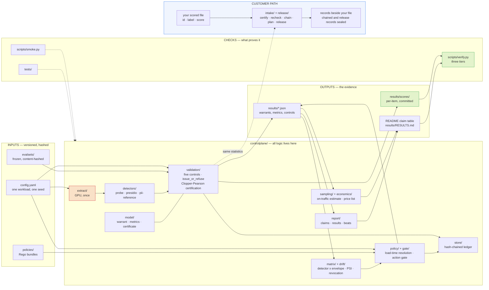

<div align="center">

<!-- Gradient banner line -->


<br/>

**A detector produces a score. A warrant is a separate, time-bounded, evidence-backed statement about what that score is worth on this distribution right now.**

<br/>

<!-- The command a customer runs needs only the first three -->
[](docs/SETUP.md#requirements)
[](requirements-customer.txt)
[](docs/INPUT.md)
[](LICENSE)

<!-- The research pipeline behind the claim table -->
[](https://pytorch.org)
[](https://scikit-learn.org)
[](https://huggingface.co/Qwen)
[](https://microsoft.github.io/presidio/)
[](docs/LIMITATIONS.md#33-other-declared-absences)

<br/>

**Certify or refuse · Recheck and revoke · Price the labels · Gate the action**

<br/>

[Quickstart](#-quickstart--certify-your-own-detector) •
[Commands](#-the-commands) •
[Claim table](#-the-claim-table) •
[Product state](docs/PRODUCT-STATE.md) •
[Architecture](#how-it-fits-together) •
[Reproduction](#-reproduction) •
[Documents](#-documents) •
[Limitations](#%EF%B8%8F-limitations-and-open-items)

<br/>


&nbsp;

&nbsp;

&nbsp;


</div>


<br/>

Everyone ships detectors. Almost nobody ships the second thing — so a guardrail
that has quietly stopped working looks exactly like one that works, and the
dashboard stays green either way. **Warrant is the instrument a model-validation
function runs.** It measures a detector on a named evaluation envelope, certifies
it against a threshold registered *before* the measurement, and **refuses when
the evidence does not support one**; policy then reads the warrant rather than
the score.

It issues no external certificate and it is not a gateway. It is the bench
instrument a second line of defence points at a control it is being asked to
rely on — bounded in time, revocable when the distribution moves, and willing to
return nothing at all.

**What is actually shipped:** an installable, local scored-file command and a
reproducible research harness. The gate, policy, drift and on-traffic studies in
this repository are demonstrations, not a deployed customer service. No customer
traffic, pilot or revenue has been evidenced. Read the [product-state and evidence
map](docs/PRODUCT-STATE.md) for the implemented surfaces, verification status and
remaining enterprise gaps before treating the claims below as a deployment claim.

**Two ways to use this repository.** Run `warrant` on your own detector's scored
file: no GPU, no model, no network, three dependencies
([Quickstart](#-quickstart--certify-your-own-detector)). Or check this project's
own measurements, every number in the [claim table](#-the-claim-table), on a
laptop ([Reproduction](#-reproduction)).

<br/>

<div align="center">
<table>
<tr>
<td align="center" width="25%">
<br/>
<br/><br/>
<sub><b>Evidence-backed, time-bounded</b><br/>keyed by detector, operating point and envelope</sub>
<br/><br/>
</td>
<td align="center" width="25%">
<br/>
<br/><br/>
<sub><b>Every claim traces to an artifact</b><br/><code>make verify</code> proves it</sub>
<br/><br/>
</td>
<td align="center" width="25%">
<br/>
<br/><br/>
<sub><b>Binomial arithmetic on your file</b><br/>no GPU, no model, no network</sub>
<br/><br/>
</td>
<td align="center" width="25%">
<br/>
<br/><br/>
<sub><b>Refuses warrants</b><br/>when evidence is absent, with no override</sub>
<br/><br/>
</td>
</tr>
</table>
</div>


<br/>

## 🧭 The three clauses, and where each one is proved

> *We tell you what your error rate is on **your** traffic, we tell you **when**
> that number stops being true, and we tell you **what it costs** to keep it
> true.*

Three sentences, three mechanisms, and each one now has an artifact behind it
rather than a plan.

| clause | mechanism | evidence |
|---|---|---|
| **what your error rate is on your traffic** | Stratified estimation over two strata: the flagged pool is a census, the unflagged pool is sampled. Recall is propagated through `dR/dq` = **-4.650**, not sized as a binomial. | [`results/on_traffic/`](results/on_traffic/ON_TRAFFIC.md) — interval coverage **96.8%** over 1,000 trials against a nominal 95% |
| **when that number stops being true** | Envelope matrix, drift detection, and a revocation ladder that turns on *evidence of breach* rather than failure to re-prove. | [`results/warrant_matrix.md`](results/warrant_matrix.md); [`results/drift/revocation_trace.json`](results/drift/revocation_trace.json) — a measured warrant revoked on a replayed shift, criteria registered before the run; `warrant recheck` |
| **what it costs to keep it true** | A computed price list. Month one at full simple-random-sampling cost, steady state at a **measured** design effect. | [`results/on_traffic/`](results/on_traffic/ON_TRAFFIC.md) — **1,399** labels for recall to ±0.05, sized so the realised margin meets it with probability 0.80 (`DECISIONS.md` 191), against the **187** this repository quoted before `DECISIONS.md` 147 |

**Yield is exact; rate is estimated.** The flagged stratum of *your traffic* is
reviewed anyway, so this month's confirmed-error count and the precision of this
month's flags are a census: no sampling interval, no extra labels. Recall needs
the whole sampling apparatus. (Precision on an *eval set*, as in the claim table
below, is a different estimand — the detector's, estimated from a sample — and
carries an interval.) They are not two views of one
measurement — they are a free claim and an expensive one, and the estimator
returns them in separate fields with different types.

### Two things certification says that scoring does not

**Refusal.** *The evidence does not support this at your budget.* No flag, no
environment variable, no admin bypass.

**Tunability.** *This detector cannot be moved to your budget at all.* A
single-sample LLM judge emits one bit, so it offers exactly **1** operating
point, and the tightest false-positive budget it can certify is whatever its own
error rate already is — **however much data you have**. Buying **51** notches
with 50 samples buys **10** operating points, not 51.

On a *simulated* judge whose runs are independent draws, that floor is **0.105**
against a data floor three orders of magnitude tighter, and five to ten samples
buys everything more samples can buy. **The judge is simulated and a real one's
repeated runs are correlated**, so that figure is an upper bound on what
sampling buys and it certifies no real detector.
([`results/scorefree/`](results/scorefree/SCOREFREE.md))

An F1 table cannot show either, because F1 is computed wherever the detector
already sits and never varies the threshold.

### And a control for when the detector loses

The action gate's two most important rules read **no detector score at all**.
Across four tools, six session states and six warrant statuses, **33 of 33**
decisions are identical whether a detector reports `CRITICAL` or reports
nothing. An indirect prompt injection that no detector flags is refused at step
**4**, on the tool's declared reversibility plus three session flags.

It costs **2** of **8** declared legitimate workflows, all **2** of them
recoverable by starting a new session — and those counts are *exact*, because
the workflow set is declared rather than sampled.
([`results/gate/`](results/gate/GATE.md))

This is **not** a robustness claim and the repository makes none. Nasr et al., *The Attacker Moves Second* ([arXiv:2510.09023](https://arxiv.org/abs/2510.09023)) bypassed **12** published injection and jailbreak defences, at an attack success rate **above 90% for most of them**, where the majority had originally reported near-zero. It is the smaller claim that survives: defeating every detector
here does not move those rules.


## ⚡ Quickstart — certify your own detector

> Five minutes on a laptop. No GPU, no model, and **nothing leaves your machine**:
> no network calls, no telemetry, no uploads. The file is read, the arithmetic is
> local, the record is written next to it.

```bash
git clone https://github.com/Aditya26189/Warrant.git
cd Warrant
python -m venv .venv && . .venv/bin/activate     # Windows: .venv\Scripts\activate
pip install -r requirements-customer.txt          # numpy, scipy, PyYAML -- nothing else

# 1. a detector with enough evidence behind it
python warrant.py certify --input examples/certifies.csv --budget 0.05

# 2. the same tool refusing -- this is the one that matters
python warrant.py certify --input examples/refuses.csv --budget 0.01
```

The first prints a threshold, a Clopper-Pearson bound on its false-positive
rate, and what the detector does there — recall, precision, flag rate and lift,
each with a 95% interval.

The second **refuses**, and exits 0 while doing it. A 1% budget needs 299 clean
negative items to certify at 95% confidence; that file has 37. No threshold on
it can be certified at that budget however good the detector is, so Warrant says
so and names both numbers. That is the tool working — a system that always
returns a number returns one when it has no business doing so, and that number
looks exactly like the ones that were earned.

### Your own detector

Three columns — `id`, `label` (0/1, **1 = the detector should fire**), `score`
(higher = more likely class 1):

```bash
python warrant.py certify --input your_scores.csv --budget 0.05
python warrant.py verify --warrant your_scores.csv.warrant.json --input your_scores.csv
```

`verify` replays the certificate from the retained scored rows and checks its
effective-row digest. It cannot establish who wrote the file or record; keep
your own custody trail. A certificate selected from a frontier also needs its
retained frontier record passed with `--frontier`.

Full contract in **[docs/INPUT.md](docs/INPUT.md)**; the two examples are
explained in [examples/README.md](examples/README.md). `pip install -e .` gives
you `warrant certify` as a command instead of `python warrant.py`. Every message
the command prints, and what to do about it, is in
[docs/TROUBLESHOOTING.md](docs/TROUBLESHOOTING.md).

**Are the labels right?** A certificate is exact about the labels it was given
and cannot see whether they are. So every certificate prints how many mislabelled
items it can take before its confidence falls below 90%, 80% and 50%, counting
separately the two errors that flatter it. On this project's own certificates
that is a handful (claim table, `DECISIONS.md` 199). If a second reviewer labelled
some items, add their labels as a `label_2` column. Warrant reports kappa and the
disputed items beside the warrant and changes nothing in it.

### Keeping it true

A warrant is a claim about the file it was issued on. On fresh labelled traffic,
`recheck` asks whether it still holds, and `plan` says what rechecking costs:

```bash
python warrant.py recheck --warrant your_scores.csv.warrant.json --input next_batch.csv
python warrant.py verify-recheck --record next_batch.csv.recheck.json --warrant your_scores.csv.warrant.json --input next_batch.csv
python warrant.py verify-chain-recheck --warrant your_scores.csv.warrant.json --pair week01.csv.recheck-0001.json week01.csv --pair week02.csv.recheck-0002.json week02.csv
python warrant.py plan --warrant your_scores.csv.warrant.json --negative-share 0.9
```

When you retain the original scored export, add
`--certificate-input your_scores.csv` to have `recheck` replay the certificate
before it measures the new batch. For a budget selected from a frontier, pass
`--certificate-frontier your_scores.csv.frontier.json`. A failed source check
writes no recheck record. Every new recheck names the exact certificate digest
and records `VERIFIED` or `NOT_CHECKED`; a digest is not a signature.

Rechecked every week, a detector that kept its promise is eventually revoked by
chance; `plan` prints how likely that is for each cadence. To make a year of
rechecks **one** test instead, declare the horizon `plan` prints once and chain
each recheck to the last (`DECISIONS.md` 187, 193, 194). Keep every record: a
chain restarted after a bad result has spent its guarantee. Give every item a
stable id that is unique across all of a chain's files -- the chain refuses an
id it has already consumed, and cannot recognise the same item under a new one.

```bash
python warrant.py recheck --warrant your_scores.csv.warrant.json --input week01.csv --horizon-labels <N from plan>
python warrant.py recheck --warrant your_scores.csv.warrant.json --input week02.csv --since week01.csv.recheck-0001.json
```

Every chained record is sealed, and `warrant chain verify` over all of a chain's
records reports an edited record, a fork, or a link that continues a revoked
warrant. **A seal is a checksum, not a signature**, and a certify warrant has no
seal at all ([docs/LIMITATIONS.md](docs/LIMITATIONS.md) §3.7).

### Evidence for one release decision

For a study whose criteria and holdout IDs are registered before evaluation, use
the separate [`warrant release` workflow](docs/RELEASE.md). It binds the declared
identity and scored holdout to reproducible evidence and checks expiry. It is
scoped detector evidence, not deployment approval.
[docs/EVIDENCE-HANDOFF.md](docs/EVIDENCE-HANDOFF.md) says what to hand a
validation function from either workflow.

<details>
<summary><strong>Reproducing this project's own measurements instead</strong></summary>

<br/>

```bash
pip install -r requirements.lock.txt
git fetch origin "refs/notes/*:refs/notes/*"     # see "Reading the history" below
make verify
```

`make verify` prints every number in the claim table below beside the value
measured on your machine, then recomputes every metrics block from the frozen
per-item scores in `results/scores/`. It exits non-zero if any of them drift.
Both of those run on a fresh clone; a third, deeper check re-derives the scores
from cached activations and reports SKIPPED without them.

</details>

---

## 🧰 The commands

Every subcommand, the question it answers, and how its exit code reads. A
certify refusal, recheck revocation and chain inspection with findings exit 0;
the certify-record verifier exits 0 only for `VERIFIED` and 1 for `MISMATCH` or
`UNVERIFIED`. Input a command cannot use exits 2. Other hard-failure modes use
the listed `--require-…` flags.

| Command | Answers | Exits 1 only when | Read |
|:---|:---|:---|:---|
| `warrant certify -i FILE -b BUDGET` | Can this file support this false-positive budget? The lowest threshold that can, or a refusal naming what is missing | `--require-warrant` and refused | [INPUT.md](docs/INPUT.md) |
| `warrant certify -i FILE --frontier` | What does every budget on the grid cost, in exact counts? | — | [GLOSSARY.md](docs/GLOSSARY.md#frontier) |
| `warrant certify -i FILE -b BUDGET --from-frontier RECORD` | Certify a budget picked off the frontier, at the level the frontier held it to | `--require-warrant` and refused | [METHODS.md](docs/METHODS.md#13-the-frontier-and-the-cost-of-choosing-from-it) §13 |
| `warrant verify -w WARRANT -i FILE [--frontier RECORD]` | Do retained rows and the certificate's material fields recompute? | Mismatch or missing evidence | [INPUT.md](docs/INPUT.md) |
| `warrant recheck -w WARRANT -i FILE` | Does the warrant still hold on fresh data? The bound and the distribution, separately | `--require-valid` and not VALID | [METHODS.md](docs/METHODS.md#14-recheck-revoke-on-evidence-of-breach) §14 |
| `warrant verify-recheck --record RECORD -w WARRANT -i FILE` | Do an ordinary recheck's fresh rows and material statistics recompute? | Mismatch or missing evidence | [INPUT.md](docs/INPUT.md) |
| `warrant verify-chain-recheck -w WARRANT --pair RECORD FILE ...` | Does a retained linear chain prefix recompute from every scored batch? | Mismatch or missing history | [INPUT.md](docs/INPUT.md) |
| `warrant recheck … --certificate-input ORIGINAL [--certificate-frontier RECORD]` | Replay the certificate before measuring new data; record which source check ran | `--require-valid` and not VALID; bad source evidence exits 2 | [INPUT.md](docs/INPUT.md) |
| `warrant recheck … --horizon-labels N`, then `--since RECORD` | A year of rechecks as one sequential test | `--require-valid` and not VALID | [METHODS.md](docs/METHODS.md#16-the-chain-one-sequential-test-over-a-declared-horizon) §16 |
| `warrant chain verify RECORD…` | Do retained record checksums and chain structure pass? | `--require-clean`: findings or missing seals fail | [TROUBLESHOOTING.md](docs/TROUBLESHOOTING.md) |
| `warrant plan -w WARRANT` | What does rechecking cost, and how often does each cadence revoke a sound detector by chance? | — | [METHODS.md](docs/METHODS.md#15-sizing-a-recheck-by-power-not-by-a-single-sufficient-count) §15 |
| `warrant release register · evaluate · verify · label-audit · verify-label-audit` | Evidence for one release decision, frozen before scoring, evaluated once, verified later; a separate audit describes fixed-threshold label fragility | `evaluate` or `verify` with `--require-valid`, and not VALID | [RELEASE.md](docs/RELEASE.md) |

The whole path from a scored file to a revoked warrant, as a diagram:
[docs/DIAGRAMS.md](docs/DIAGRAMS.md) §12–14.

---

## 🚫 What this is not

> Stating the scope is worth more than having it inferred.

| | |
|:---|:---|
| 🔒 **Not deployed** | No auth, no rate limiting, no HA, no deployment manifests. There is no serving layer and adding one is explicitly out of scope. |
| ⚖️ **Not a verdict** | A detector is a trigger for spending an expensive check. Nothing here blocks, filters or gates a user-facing response. |
| 🔬 **Not a general result** | Measured on 2,400 TriviaQA items and hand-built PII sets, one model family (Qwen2.5-7B-Instruct, NF4), no real production traffic. |
| 🚧 **Priced, not yet paid for** | The price list and the action gate are built (`DECISIONS.md` 146-150, 156, 183, 191): `controlplane/economics/sizing.py` and `controlplane/sampling/` compute every label budget from the one `workload` block, and each figure names the inputs it was declared on. **No production traffic and no customer exist**, so none of those budgets has been spent against real labels, and any money, headcount or ROI figure outside those modules is a declared estimate. The closure of `DECISIONS.md` 096 and 099 is recorded in [docs/LIMITATIONS.md](docs/LIMITATIONS.md) §3.1-3.2. |
| 🧠 **Not a claim about truthfulness** | The probe is a correlational classifier over activations. It does not measure what a model believes. |
| 🔏 **Not tamper-proof** | Chained recheck records, release evaluations and release label-audit companions carry checksums. A checksum is not a signature: anyone who can write the records can recompute it. |
| 🏦 **Not a compliance certificate** | The RBI crosswalk is a register of evidence types against a **draft**, not compliance approval ([docs/RBI-MRM-2026-CROSSWALK.md](docs/RBI-MRM-2026-CROSSWALK.md)). |

---

## 📊 The claim table

Every quantitative claim this repository makes, the artifact that contains it,
and the field inside that artifact. `make verify` parses these tables, resolves
each field, and compares at the precision quoted. **A number edited by hand
here fails the build.**

> Intervals are 95%. Unless a row says otherwise they are bootstrap-percentile,
> 1,000 resamples over questions, seed 1729. Two rows differ: the paired AUROC
> difference bootstraps 2,000 paired resamples, and the false-positive rate on
> benign traffic, with no event to resample, is Clopper-Pearson exact. A row with
> `-` is an exact count or a property of a frozen set, a simulated operating
> characteristic, or a figure derived from declared inputs.

**Groups:** [The probe](#the-probe-on-the-envelope-it-was-measured-on) ·
[What a budget buys](#what-a-looser-budget-buys) · [Three profiles](#three-profiles-on-one-measured-curve) ·
[When the distribution moves](#when-the-distribution-moves) · [The matrix](#the-warrant-matrix) ·
[PII detectors](#pii-detectors-including-the-ones-refused) · [What no selector can do](#what-no-selector-can-do) ·
[What keeping it true costs](#what-keeping-it-true-costs-in-labels) ·
[Rechecks and label error](#rechecks-chains-and-label-error) · [No score](#a-detector-with-no-score) ·
[The action gate](#the-action-gate)

### The probe, on the envelope it was measured on

| Claim | Value | Interval | Artifact | Field | Regenerate |
|---|---|---|---|---|---|
| Probe AUROC, `triviaqa-600`, n=600 | 0.8256 | [0.7934, 0.8567] | results/validation-T1-last_token.json | metrics.auroc.value | make verify |
| Probe recall at its operating point | 0.0794 | [0.0496, 0.1115] | results/validation-T1-last_token.json | metrics.recall.value | make verify |
| Probe precision there | 0.8800 | [0.7500, 1.0000] | results/validation-T1-last_token.json | metrics.precision.value | make verify |
| Measured flag rate there | 0.0417 | [0.0267, 0.0583] | results/validation-T1-last_token.json | metrics.flag_rate.value | make verify |
| Base error rate of that envelope | 0.4617 | - | results/validation-T1-last_token.json | base_rate | make verify |
| Round 1 reproduced on Round 2's pipeline | 0.8256 | - | results/reconciliation.json | round2.T1-last_token.test_auroc | make verify |
| ...landing inside Round 1's published interval | A | - | results/reconciliation.json | branch | make verify |
| Cost of the training reduction, paired on 600 held-out items | -0.0110 | [-0.0200, -0.0026] | results/paired_comparison.json | pinned_to_baseline_threshold[quantity=auroc].difference | make verify |
| Selection-aware widening of the recall bound | 1.5922 | - | results/paired_comparison.json | selection_aware_bounds[operating_point_id=P-customer-support].widening | make verify |

**Read the probe recall with its base rate.** 0.0794 recall at a 4.2% flag rate
is a `lift` of roughly 1.9x over random sampling at the same budget, and the
ceiling at base rate 0.4617 is 2.17x. The headline is not "the probe is
accurate". It is that the number, its interval and its ceiling are all on the
record, and that the same machinery **refuses** detectors it was pointed at: two
of this project's own probe aggregations under long context, and two Presidio
configurations on Hinglish PII.

The training-reduction row is a correction: an earlier commit claimed the
reduction cost nothing, and the paired comparison found otherwise
([Reading the history](#-reading-the-history)). The widening row is the
selection-aware bound on the recall interval, which is conditional on a threshold
set by few validation items ([docs/LIMITATIONS.md](docs/LIMITATIONS.md) §2.2).

### What a looser budget buys

| Claim | Value | Interval | Artifact | Field | Regenerate |
|---|---|---|---|---|---|
| Largest FPR budget where lift still holds | 0.20 | - | results/fpr_sweep/sweep.json | sweeps[eval_set_id=triviaqa-600].headline.largest_target_fpr_where_lift_holds | python scripts/19_fpr_sweep.py |
| Recall there — the same probe, a looser budget | 0.6462 | [0.5950, 0.7051] | results/fpr_sweep/sweep.json | sweeps[eval_set_id=triviaqa-600].points[target_fpr=0.2].recall.value | python scripts/19_fpr_sweep.py |
| Precision there | 0.7749 | [0.7227, 0.8290] | results/fpr_sweep/sweep.json | sweeps[eval_set_id=triviaqa-600].points[target_fpr=0.2].precision.value | python scripts/19_fpr_sweep.py |
| Lift there, against a 2.17 ceiling | 1.678 | [1.545, 1.831] | results/fpr_sweep/sweep.json | sweeps[eval_set_id=triviaqa-600].points[target_fpr=0.2].lift.value | python scripts/19_fpr_sweep.py |
| ...and it survives the long-context shift | 0.6209 | [0.5667, 0.6815] | results/fpr_sweep/sweep.json | sweeps[eval_set_id=triviaqa-longctx-600].points[target_fpr=0.2].recall.value | python scripts/19_fpr_sweep.py |
| ...its precision there | 0.7679 | [0.7137, 0.8214] | results/fpr_sweep/sweep.json | sweeps[eval_set_id=triviaqa-longctx-600].points[target_fpr=0.2].precision.value | python scripts/19_fpr_sweep.py |
| **Out-of-sample** recall at the same budget | 0.6318 | [0.5782, 0.6880] | results/fpr_sweep_oos/sweep.json | sweeps[eval_set_id=triviaqa-600].points[target_fpr=0.2].recall.value | python scripts/20_fpr_sweep_oos.py |
| ...its precision | 0.7743 | [0.7220, 0.8281] | results/fpr_sweep_oos/sweep.json | sweeps[eval_set_id=triviaqa-600].points[target_fpr=0.2].precision.value | python scripts/20_fpr_sweep_oos.py |
| ...its lift | 1.677 | [1.535, 1.826] | results/fpr_sweep_oos/sweep.json | sweeps[eval_set_id=triviaqa-600].points[target_fpr=0.2].lift.value | python scripts/20_fpr_sweep_oos.py |
| Thresholds certified on validation, scored on test | True | - | results/fpr_sweep_oos/sweep.json | sweeps[eval_set_id=triviaqa-600].out_of_sample | python scripts/20_fpr_sweep_oos.py |

**Recall 0.0794 is a dial, not a ceiling.** These rows are a sweep of the
false-positive budget across the same frozen scores
([results/fpr_sweep/](results/fpr_sweep/)). Loosening the budget from the
shipped operating point to a 20% target moves recall from 0.0794 to **0.6462**
— 8.1x — while precision falls only 0.88 → 0.77 and lift stays between 1.68 and
1.98 across every target where it holds, 77–91% of the 2.17 ceiling. ("Holds" is
the pre-registered term and means its 95% lower bound clears 1.0; it is not used
loosely here.) What was binding was the false-positive budget, not the probe's
ability to separate the classes. The criterion for "lift holds" was registered
before the sweep ran; `DECISIONS.md` 126.

Those figures are in-sample. Certifying thresholds on the **validation** split
and scoring them on test gives recall **0.6318 [0.5782, 0.6880]** at the same
budget — 0.0144 below the in-sample number, and lift holds at 20 of 20 targets
rather than 19. The certified budget was respected on the unseen split at every
one of the twenty. `DECISIONS.md` 134 closes 124 on that basis; the in-sample
table is kept as the evidence for how little the bias moved.

### Three profiles on one measured curve

| Claim | Value | Interval | Artifact | Field | Regenerate |
|---|---|---|---|---|---|
| `customer_support` recall, n=960 | 0.2171 | [0.1800, 0.2564] | results/policy-triviaqa-2400-t960.json | operating_points[operating_point.operating_point_id=P-customer-support].metrics.recall.value | make verify |
| `customer_support` measured flag rate | 0.1062 | [0.0885, 0.1260] | results/policy-triviaqa-2400-t960.json | operating_points[operating_point.operating_point_id=P-customer-support].metrics.flag_rate.value | make verify |
| `customer_support` precision | 0.9216 | [0.8676, 0.9684] | results/policy-triviaqa-2400-t960.json | operating_points[operating_point.operating_point_id=P-customer-support].metrics.precision.value | make verify |
| `internal_knowledge` recall, n=960 | 0.3603 | [0.3173, 0.4063] | results/policy-triviaqa-2400-t960.json | operating_points[operating_point.operating_point_id=P-internal-knowledge].metrics.recall.value | make verify |
| `internal_knowledge` measured flag rate | 0.1865 | [0.1635, 0.2125] | results/policy-triviaqa-2400-t960.json | operating_points[operating_point.operating_point_id=P-internal-knowledge].metrics.flag_rate.value | make verify |
| `internal_knowledge` precision | 0.8715 | [0.8218, 0.9214] | results/policy-triviaqa-2400-t960.json | operating_points[operating_point.operating_point_id=P-internal-knowledge].metrics.precision.value | make verify |
| `decision_support` recall, n=960 | 0.7367 | [0.6974, 0.7783] | results/policy-triviaqa-2400-t960.json | operating_points[operating_point.operating_point_id=P-decision-support].metrics.recall.value | make verify |
| `decision_support` measured flag rate | 0.4677 | [0.4365, 0.4990] | results/policy-triviaqa-2400-t960.json | operating_points[operating_point.operating_point_id=P-decision-support].metrics.flag_rate.value | make verify |
| `decision_support` precision | 0.7105 | [0.6690, 0.7506] | results/policy-triviaqa-2400-t960.json | operating_points[operating_point.operating_point_id=P-decision-support].metrics.precision.value | make verify |

Same detector, same envelope; only the flag-rate budget moves. Recall and
precision travel together in every row pair, because a recall figure alone reads
as a clean win ([docs/CASES.md](docs/CASES.md) §3).

### When the distribution moves

| Claim | Value | Interval | Artifact | Field | Regenerate |
|---|---|---|---|---|---|
| Last-token probe survives the long-context shift | 0.8135 | [0.7797, 0.8447] | results/transfer-T1-last_token.json | target.metrics.auroc.value | make verify |
| Mean-pool probe collapses to chance under it | 0.5015 | [0.4546, 0.5479] | results/transfer-T1-mean_pool.json | target.metrics.auroc.value | make verify |
| Max-rolling-means probe under it | 0.5553 | [0.5105, 0.6015] | results/transfer-T1-max_rolling_means.json | target.metrics.auroc.value | make verify |
| ...and it flags 54% of the stream | 0.5433 | [0.5050, 0.5833] | results/transfer-T1-max_rolling_means.json | target.metrics.flag_rate.value | make verify |
| Replayed shift to long context begins at request | 401 | - | results/drift/revocation_trace.json | stream.shift_starts_at_request | python scripts/28_revocation_trace.py |
| ...the probe's warrant is revoked at request | 450 | - | results/drift/revocation_trace.json | revocation.at_request | python scripts/28_revocation_trace.py |
| ...at a PSI of | 0.3526 | - | results/drift/revocation_trace.json | checkpoints[after_request=450].psi | python scripts/28_revocation_trace.py |
| ...where the last all-normal window read | 0.0543 | - | results/drift/revocation_trace.json | checkpoints[after_request=400].psi | python scripts/28_revocation_trace.py |

The same fitted probe, three aggregations, one long-context shift, nothing
retrained. Mean-pooling collapses to chance **while flagging almost nothing**,
which a conventional dashboard reads as clean traffic. The last four rows replay a
real stream through the drift monitor, with its criteria registered before the
run (`DECISIONS.md` 178).

### The warrant matrix

| Claim | Value | Interval | Artifact | Field | Regenerate |
|---|---|---|---|---|---|
| Warrant matrix cells VALID | 13 | - | results/warrant_matrix.json | matrix.summary.VALID | make verify |
| Warrant matrix cells REFUSED | 4 | - | results/warrant_matrix.json | matrix.summary.REFUSED | make verify |
| Warrant matrix cells never measured | 39 | - | results/warrant_matrix.json | matrix.summary.UNVALIDATED | make verify |

39 of 56 cells are UNVALIDATED. That is not a gap in the work — it is the
expected shape of the thing. UNVALIDATED is the modal state in any real
deployment, and a system that cannot say *"this detector has never been measured
on this distribution"* will instead say something confident and wrong. Of the
populated cells, several are synthetic fixtures, and [results/RESULTS.md](results/RESULTS.md)
refuses to print their numbers ([docs/LIMITATIONS.md](docs/LIMITATIONS.md) §2.4).

### PII detectors, including the ones refused

| Claim | Value | Interval | Artifact | Field | Regenerate |
|---|---|---|---|---|---|
| `presidio-stock` recall on Hinglish PII, REFUSED | 0.1176 | [0.0500, 0.2000] | results/detectors.json | runs[detector_id=presidio-stock,eval_set_id=hinglish-pii-200].metrics.recall.value | make verify |
| ...its precision there | 0.5455 | [0.2592, 0.9002] | results/detectors.json | runs[detector_id=presidio-stock,eval_set_id=hinglish-pii-200].metrics.precision.value | make verify |
| `presidio-enabled` recall, REFUSED | 0.2843 | [0.2075, 0.3810] | results/detectors.json | runs[detector_id=presidio-enabled,eval_set_id=hinglish-pii-200].metrics.recall.value | make verify |
| ...its precision there | 0.7436 | [0.5416, 0.9584] | results/detectors.json | runs[detector_id=presidio-enabled,eval_set_id=hinglish-pii-200].metrics.precision.value | make verify |
| `presidio-enabled_plus_custom` recall, VALID | 0.6176 | [0.5185, 0.7128] | results/detectors.json | runs[detector_id=presidio-enabled_plus_custom,eval_set_id=hinglish-pii-200].metrics.recall.value | make verify |
| ...its precision there | 0.8630 | [0.7262, 0.9828] | results/detectors.json | runs[detector_id=presidio-enabled_plus_custom,eval_set_id=hinglish-pii-200].metrics.precision.value | make verify |
| Our `pii-reference` recall, VALID | 0.7941 | [0.6981, 0.8846] | results/detectors.json | runs[detector_id=pii-reference,eval_set_id=hinglish-pii-200].metrics.recall.value | make verify |
| ...its precision there | 0.6532 | [0.5114, 0.8100] | results/detectors.json | runs[detector_id=pii-reference,eval_set_id=hinglish-pii-200].metrics.precision.value | make verify |
| `presidio-stock` reproduces out of sample | 0.1471 | [0.0714, 0.2341] | results/holdout/detectors.json | runs[detector_id=presidio-stock,eval_set_id=hinglish-pii-200b].metrics.recall.value | make verify |
| ...its precision there | 0.5357 | [0.2812, 0.8621] | results/holdout/detectors.json | runs[detector_id=presidio-stock,eval_set_id=hinglish-pii-200b].metrics.precision.value | make verify |
| `pii-reference` false-positive rate on benign traffic | 0.0000 | [0.0000, 0.0183] | results/validation-pii-reference-hard-negatives-200.json | metrics.flag_rate.value | make verify |

The Presidio finding is a statement about one pinned version, which is inside the
refusal reason. The `enabled_plus_custom` recognizers were partly fitted on the
set they are measured on ([docs/LIMITATIONS.md](docs/LIMITATIONS.md) §2.3).

### What no selector can do

| Claim | Value | Interval | Artifact | Field | Regenerate |
|---|---|---|---|---|---|
| Abstention floor at a 5% residual-risk target | 0.4221 | - | results/feasibility.json | abstention_floor[target_risk=0.05].floor | python scripts/11_feasibility.py |
| ...at a 10% target | 0.3900 | - | results/feasibility.json | abstention_floor[target_risk=0.1].floor | python scripts/11_feasibility.py |
| Residual risk `decision_support` actually ships | 0.2231 | - | results/feasibility.json | profiles[operating_point_id=P-decision-support].achieved_risk.residual_risk | python scripts/11_feasibility.py |
| ...costing this multiple of the perfect-selector floor | 1.5941 | - | results/feasibility.json | profiles[operating_point_id=P-decision-support].achieved_risk.efficiency | python scripts/11_feasibility.py |
| `customer_support` at the same measure | 1.1490 | - | results/feasibility.json | profiles[operating_point_id=P-customer-support].achieved_risk.efficiency | python scripts/11_feasibility.py |

These rows are the one part of this table that is not about our detector. Given a
measured base error rate, holding residual risk at 5% requires abstaining on at
least 42.2% of traffic — for *any* selector, however good. That is an
impossibility result, and it is why "just tighten the threshold" is not an
available answer. The two efficiency rows say how far each operating point sits
above that floor at the risk it actually ships: 1.15× at `customer_support`,
1.59× at `decision_support`. See [docs/PROPOSAL.md](docs/PROPOSAL.md) §1–2.

### What keeping it true costs in labels

| Claim | Value | Interval | Artifact | Field | Regenerate |
|---|---|---|---|---|---|
| `dR/dq` at the declared workload | -4.6496 | - | results/on_traffic/on_traffic.json | headline.derivative | python scripts/25_on_traffic.py |
| Unflagged pool against confirmed true positives | 231.9 | - | results/on_traffic/on_traffic.json | headline.amplification_over_confirmed_errors | python scripts/25_on_traffic.py |
| ...against the flagged pool, which is a different ratio | 66.0 | - | results/on_traffic/on_traffic.json | headline.pool_ratio_over_flagged | python scripts/25_on_traffic.py |
| Labels for recall +/-0.05, month one, full SRS cost, 0.80 assurance | 1399 | - | results/on_traffic/on_traffic.json | headline.labels_month_one_5pp | python scripts/25_on_traffic.py |
| ...at steady state, Neyman at the measured design effect | 1109 | - | results/on_traffic/on_traffic.json | headline.labels_steady_state_5pp | python scripts/25_on_traffic.py |
| ...what the superseded sizing quoted (DECISIONS 147) | 187 | - | results/on_traffic/on_traffic.json | headline.superseded_sizing_5pp | python scripts/25_on_traffic.py |
| Labels for recall +/-0.02, month one | 6518 | - | results/on_traffic/on_traffic.json | headline.labels_month_one_2pp | python scripts/25_on_traffic.py |
| Recall-interval coverage, 1000 trials, nominal 0.95 | 0.9680 | - | results/on_traffic/on_traffic.json | headline.coverage | python scripts/25_on_traffic.py |
| ...over how many trials | 1000 | - | results/on_traffic/on_traffic.json | headline.coverage_trials | python scripts/25_on_traffic.py |
| Measured Neyman design effect vs the declared 0.67 | 0.7929 | - | results/on_traffic/on_traffic.json | headline.measured_design_effect | python scripts/25_on_traffic.py |

Recall on traffic nobody reviewed is estimated from a sample of the unflagged
pool, so its label budget is sized through the derivative of recall, not as a
prevalence ([docs/METHODS.md](docs/METHODS.md) §18). The workload is declared,
not observed, and coverage is measured on simulated traffic with known truth.

### Rechecks, chains and label error

| Claim | Value | Interval | Artifact | Field | Regenerate |
|---|---|---|---|---|---|
| A year of weekly per-recheck tests revokes a detector that kept its promise, share of simulated years (DECISIONS 187) | 0.8515 | - | results/recheck_schedules/comparison.json | cells[rule=fixed,cadence=weekly,scenario=S0].revoked_in_year.value | python scripts/29_recheck_schedules.py |
| ...a chained recheck on the same labels (DECISIONS 193) | 0.0085 | - | results/recheck_schedules/comparison.json | cells[rule=e_detector,cadence=weekly,scenario=S0].revoked_in_year.value | python scripts/29_recheck_schedules.py |
| A breach after six months at the certified rate, caught within 13 weeks, by FPRMonitor | 0.0005 | - | results/recheck_schedules/comparison.json | cells[rule=monitor,cadence=weekly,scenario=S3].caught_in_window.value | python scripts/29_recheck_schedules.py |
| ...by the chained recheck | 1.0000 | - | results/recheck_schedules/comparison.json | cells[rule=e_detector,cadence=weekly,scenario=S3].caught_in_window.value | python scripts/29_recheck_schedules.py |
| Monthly chained rechecks, 628 negatives each, catch a 1.5x breach within three months, share of simulated years (DECISIONS 196) | 0.8325 | - | results/chain_detection/grid.json | cells[breach=0.075,cadence=monthly-6,scenario=S2,rule=e_detector].caught_in_window.value | python scripts/31_chain_detection.py |
| ...weekly, a 1.5x breach from week 26, within 13 weeks | 0.9965 | - | results/chain_detection/grid.json | cells[breach=0.075,cadence=weekly-26,scenario=S2,rule=e_detector].caught_in_window.value | python scripts/31_chain_detection.py |
| This project's measured TriviaQA certificates: the fewest flagged positives that, if really clean, take one below 0.80 confidence, over all certified rows (DECISIONS 199) | 2 | - | results/label_sensitivity/triviaqa.json | criteria.reported.flagged_clean_errors_to_fall_below_0_80_min | python scripts/32_label_sensitivity.py |
| ...the most, over the same rows | 8 | - | results/label_sensitivity/triviaqa.json | criteria.reported.flagged_clean_errors_to_fall_below_0_80_max | python scripts/32_label_sensitivity.py |
| ...certified rows in that range (3 probes x 20 budgets) | 60 | - | results/label_sensitivity/triviaqa.json | criteria.reported.certified_rows | python scripts/32_label_sensitivity.py |
| ...the lowest confidence among them if every strict-vs-lenient matching dispute were a lenient labelling error | 0.8127 | - | results/label_sensitivity/triviaqa.json | criteria.reported.confidence_at_disputes_min | python scripts/32_label_sensitivity.py |
| ...the highest | 0.9412 | - | results/label_sensitivity/triviaqa.json | criteria.reported.confidence_at_disputes_max | python scripts/32_label_sensitivity.py |

Every row here is a simulated operating characteristic of a rule, or a
re-certification of frozen scores, not a new measurement of any detector. The
detection rows cover one budget, step changes and the settings simulated
([docs/LIMITATIONS.md](docs/LIMITATIONS.md) §3.5); the label rows count one
error kind at a time, on this project's own lenient labels (§3.6).

### A detector with no score

| Claim | Value | Interval | Artifact | Field | Regenerate |
|---|---|---|---|---|---|
| Tightest budget a single-sample judge can certify | 0.1045 | - | results/scorefree/scorefree.json | headline.single_sample_floor_median | python scripts/26_scorefree.py |
| ...distinct operating points it offers | 1 | - | results/scorefree/scorefree.json | headline.operating_points_at_k1 | python scripts/26_scorefree.py |
| Notches at k=50 | 51 | - | results/scorefree/scorefree.json | headline.notches_at_k50 | python scripts/26_scorefree.py |
| ...distinct operating points they actually buy | 10 | - | results/scorefree/scorefree.json | headline.operating_points_at_k50 | python scripts/26_scorefree.py |
| Samples before granularity stops binding, 200 negatives | 3 | - | results/scorefree/scorefree.json | headline.crossover_k_smallest_pool | python scripts/26_scorefree.py |
| ...at 20,000 negatives | 7 | - | results/scorefree/scorefree.json | headline.crossover_k_largest_pool | python scripts/26_scorefree.py |
| AUROC lost to a single sample | 0.2288 | - | results/scorefree/scorefree.json | headline.auroc_gap_at_k1 | python scripts/26_scorefree.py |
| ...at nine samples | 0.0215 | - | results/scorefree/scorefree.json | headline.auroc_gap_at_k9 | python scripts/26_scorefree.py |
| Certified at k=9, deployed at k=1: breach of the bound | 2.3521 | - | results/scorefree/scorefree.json | headline.breach_factor_deploying_at_k1 | python scripts/26_scorefree.py |

The judge is **simulated**, with independent repeated runs; a real judge's runs
are correlated, so these bound what sampling can buy and certify no real detector
([results/scorefree/](results/scorefree/SCOREFREE.md)).

### The action gate

| Claim | Value | Interval | Artifact | Field | Regenerate |
|---|---|---|---|---|---|
| Gate decisions made without reading any detector | 33 | - | results/gate/gate.json | headline.decisions_identical_without_a_detector | python scripts/27_gate.py |
| ...of how many rule-1/rule-2 decisions swept | 33 | - | results/gate/gate.json | headline.decisions_compared | python scripts/27_gate.py |
| Injection blocked at step | 4 | - | results/gate/gate.json | headline.injection_blocked_at_step | python scripts/27_gate.py |
| ...and the detector that flagged it | False | - | results/gate/gate.json | headline.injection_flagged_by_detector | python scripts/27_gate.py |
| Legitimate workflows the gate blocks (EXACT, declared set) | 2 | - | results/gate/gate.json | headline.legitimate_workflows_blocked | python scripts/27_gate.py |
| ...of how many declared | 8 | - | results/gate/gate.json | headline.legitimate_workflows | python scripts/27_gate.py |
| ...that a new session recovers | 2 | - | results/gate/gate.json | headline.blocked_workflows_recoverable | python scripts/27_gate.py |

Counts over a declared set of tools, session states and workflows, so they are
exact rather than sampled, and **not** a robustness claim
([results/gate/](results/gate/GATE.md)).

---

## 🗂️ Repo map

```
warrant.py             the command a customer runs (installed as `warrant`)
controlplane/          the package, and all of the logic
  intake/ release/       the customer path: certify, recheck, chain; release evidence
  validation/ matrix/    controls, issue_or_refuse, the detector x envelope matrix
  drift/ policy/ gate/   revocation, load-time warrant resolution, the action gate
  sampling/ economics/   the on-traffic estimate, the price list, the feasibility bound
  model/ store/ ...      records, the ledger, detectors, extraction, reports
examples/              two scored files: one certifies, one refuses
evalsets/ & results/   frozen content-hashed evaluation sets; every artifact behind the table above
scripts/ & demo/       thin CLI wrappers, the two-pane demo runner
notebooks/             the Kaggle GPU notebook (generated, never hand-edited)
tests/                 2102 tests collected, including the ones that enforce this README
docs/                  guides, orientation, methods, limitations, the case matrix
DECISIONS.md           the append-only decision log, with dated addenda
reports/               one close-out report per sprint, leading with the answer
round1/                the Round 1 submission, moved whole
```

### How it fits together

> Read left to right: the GPU stage runs once and caches, everything downstream
> reads from disk, and the last column is what a stranger can check without a GPU.
> The customer path at the bottom shares the certification statistics and nothing
> else.



`scripts/` and `demo/` are thin wrappers around the package and hold no logic of
their own. Fifteen diagrams, including the customer path, a chain of rechecks and
the action gate, are in [docs/DIAGRAMS.md](docs/DIAGRAMS.md); the prose version is
[docs/ARCHITECTURE.md](docs/ARCHITECTURE.md), and the package-by-package tour is
[docs/CODE_TOUR.md](docs/CODE_TOUR.md).

---

## 🔬 Reproduction

| Target | Without `make` | Requires | Time | Proves |
|:---|:---|:---|:---|:---|
| `make smoke` | `python scripts/smoke.py` | CPU, no network | < 60s | The clone works and the package imports |
| `make test` | `python -m pytest tests/ -q` | CPU | ~10 min | 2102 tests collected |
| `make verify` | `python scripts/verify.py` | CPU | ~3 min | **Every claim reproduces, and every metric recomputes from frozen scores** |
| `make verify` (tier 3) | `python scripts/verify.py` | CPU + cached activations | ~4 min | The frozen scores re-derive from the activations |
| `make extract` | `python scripts/00_extract.py --config config.yaml` | GPU, 16 GB | ~1 h | Activations regenerate from the source model |

Every recipe in the Makefile is a single command with no shell logic in it, so
the middle column is exact rather than approximate. If you are on Windows
without make, use it directly.

<details>
<summary><strong>🔍 <code>make verify</code> — the three tiers</strong></summary>

<br/>

`make verify` is the "prove it" button as a command line. Three checks,
weakest first, each proving something the one before it cannot:

1. **The claim table against the committed artifacts.** Resolves every field
   named above and compares at the quoted precision. Needs nothing but the
   repository. Cannot detect a README and a set of artifacts that went stale
   *together*.
2. **Every metrics block recomputed from frozen per-item scores.** Catches
   exactly that: an artifact whose numbers no longer follow from the data behind
   them. `results/scores/` holds the labels, scores and question ids for all 24
   measured (detector, envelope) blocks — about 200 KB, committed — and the
   recomputation uses the same builder, bootstrap count and seed. **This runs on
   a fresh clone**, which is the entire reason the scores are committed rather
   than the activations.
3. **The frozen scores against a re-run from cached activations.** The deepest
   tier and the only one that closes the loop back to the model: check 2 proves
   the metrics follow from the recorded scores, not that those scores came from
   the model and probe the artifact names. The caches are ~100 MB and
   gitignored, so on a fresh clone this reports **SKIPPED** — never a pass it
   did not earn, and the final line names any tier that did not run.

All three exit non-zero on drift. Nothing in `results/` is written by any of
them: the re-run goes to a scratch directory, so a failed verification cannot
damage the evidence it was checking.

Nobody will run `make extract`. It is documented anyway, so the chain from raw
model to published number has no gap in it. The tested GPU path is
[notebooks/run_on_kaggle.ipynb](notebooks/run_on_kaggle.ipynb), which is
generated by `scripts/build_notebooks.py` and never hand-edited.

</details>

---

## 📜 Reading the history

Run this once after cloning:

```bash
git fetch origin "refs/notes/*:refs/notes/*"
```

Commit `67167ed` states that reducing the training set from 1200 to 960 items
"cost nothing measurable". **That claim is wrong**, and a git note attached to
that commit says so: the comparison was confounded, because the training size
and the evaluation sample both changed between the two numbers. The paired
comparison on the 600 items both models held out found the opposite — the
reduction cost 0.0110 AUROC [0.0026, 0.0200], an interval that excludes zero.

The history was not rewritten. A withdrawn claim that stays visible next to its
correction is worth more than a clean log, and the correction is only visible if
you fetch the notes ref — which is why this is in the setup section rather than
in a footnote. `DECISIONS.md` 081 carries the full argument.

---

## ⚠️ Limitations and open items

> [!WARNING]
> Read [docs/LIMITATIONS.md](docs/LIMITATIONS.md) before quoting anything here.

The ones that would change how you read the table:

- **Calibration drift is detectable at 25%, not at 10%.** Separating a 25%
  deviation from the declared flag-rate budget needs n ≥ 1441; these envelopes
  were measured at n = 600 to 960. Every budget claim is refused or unresolved.
- **Every published recall interval was conditional on a threshold set by as
  few as five validation items.** The selection-aware bounds are 1.36x to 1.59x
  wider (`DECISIONS.md` 083). The table above quotes the conditional interval
  and names the widening in its own row.
- **The `enabled_plus_custom` recognizers were fitted on the set they are
  measured on.** 11 of 34 patterns are spec-derived; the rest are fitted, and
  the out-of-sample holdout is underpowered (`DECISIONS.md` 086, 087).
- **`DECISIONS.md` 080 is unresolved**, and the D.2 measured-pair gap is open.
- **8 of 17 populated matrix cells are synthetic fixtures.** Their numbers are
  refused rather than printed — see the warning at the top of
  [results/RESULTS.md](results/RESULTS.md).
- **The sweep is out-of-sample within one corpus, not out-of-distribution.**
  Thresholds are certified on the validation split and scored on test
  (`results/fpr_sweep_oos/`), which removes the in-sample bias `DECISIONS.md`
  124 was open about — that entry is now closed by 134. What it does not
  establish is transfer to another corpus: both splits are drawn from the same
  frozen 2400 items, at n=600 each, one model, no production traffic. The
  long-context transfer set is the nearest thing to that second question and is
  reported separately.
- **The Presidio finding is a statement about `presidio-analyzer==2.2.364`.**
  It is pinned, the version is inside the refusal reason, and a test fails if
  the environment drifts from the pin.
- **Drift is watched on one feature.** Only input token length is computed;
  four declared envelope features and MMD are not, so a shift in language or
  topic at a constant length passes unseen (`DECISIONS.md` 172).
- **A monthly chain misses breaches more often than a weekly one.** Monthly
  chained rechecks at their 0.80-power size caught a 1.5x breach within three
  months in 0.8325 of simulated years; weekly rechecks caught it within 13 weeks
  in 0.9965 (`DECISIONS.md` 196).
- **A certificate is exact about its labels and blind to whether they are
  right.** On this project's own certificates, 2 to 8 flagged positives that are
  really clean take one below 0.80 confidence (`DECISIONS.md` 199).
- **No customer traffic, no human labels, no pilot.** Every figure about the
  customer path is a property of the method, measured on this project's data or
  simulated.

---

## 📚 Documents

[docs/README.md](docs/README.md) indexes all of them and routes by what you came
for. The ones most readers want first:

| Document | What it answers |
|:---|:---|
| 📥 [INPUT.md](docs/INPUT.md) · [RELEASE.md](docs/RELEASE.md) | The input contract for your own file; a pre-registered release study, step by step |
| 🤝 [EVIDENCE-HANDOFF.md](docs/EVIDENCE-HANDOFF.md) | What to hand a validation function, field by field, and what no record carries yet |
| 📐 [DIAGRAMS.md](docs/DIAGRAMS.md) | The system in fifteen diagrams — objects, pipeline, warrant lifecycle, controls, policy, drift, verification, the customer path, the chain, release, the gate |
| 🏗️ [ARCHITECTURE.md](docs/ARCHITECTURE.md) | What the system is, the three ways into it, and how the pieces fit |
| 🚀 [ONBOARDING.md](docs/ONBOARDING.md) | Your first hour in this repository, in order |
| ⚙️ [SETUP.md](docs/SETUP.md) · [RUNBOOK.md](docs/RUNBOOK.md) | Getting it running; what every script and subcommand reads and writes |
| 🔧 [TROUBLESHOOTING.md](docs/TROUBLESHOOTING.md) | What a crash, a refusal or a `warrant` message actually means |
| 📏 [METHODS.md](docs/METHODS.md) | Estimators, bootstraps, null bands, certification, recheck, the chain, label error: each with its derivation |
| 📋 [CASES.md](docs/CASES.md) | Every case, the test covering it, the artifact demonstrating it |
| ⚠️ [LIMITATIONS.md](docs/LIMITATIONS.md) | Scope, declared gaps, open items |
| 📝 [DECISIONS.md](DECISIONS.md) | The append-only log — "why did you do it that way?" |
| 📦 [ARTIFACTS.md](docs/ARTIFACTS.md) · [TESTING.md](docs/TESTING.md) | Every output file and record, and its fields; what the suite defends |
| 🗺️ [CODE_TOUR.md](docs/CODE_TOUR.md) · [GLOSSARY.md](docs/GLOSSARY.md) | The packages, file by file; the vocabulary, defined once |
| ❓ [FAQ.md](docs/FAQ.md) · [JOURNEY.md](docs/JOURNEY.md) | Reviewer and validation-team questions; what the project did, build phase by sprint |
| 🏦 [RBI-MRM-2026-CROSSWALK.md](docs/RBI-MRM-2026-CROSSWALK.md) · [PILOT-PROTOCOL.md](docs/PILOT-PROTOCOL.md) | Where a warrant can supply evidence under the RBI's draft guidance; what a first pilot would test. A register and a plan, not a compliance claim and not a result |
| 📄 [SPEC.md](docs/SPEC.md) · 💼 [PROPOSAL.md](docs/PROPOSAL.md) | The technical specification; the business proposal |

---

## 📄 Licence

<div align="center">

<br/>


<br/><br/>

<em>Every dependency is MIT, Apache-2.0 or BSD; the stack is open and self-hostable,<br/>which is why Llama Guard and ShieldGemma are deliberately absent.</em>

<br/><br/>

<a href="#"></a>

</div>

<br/>


