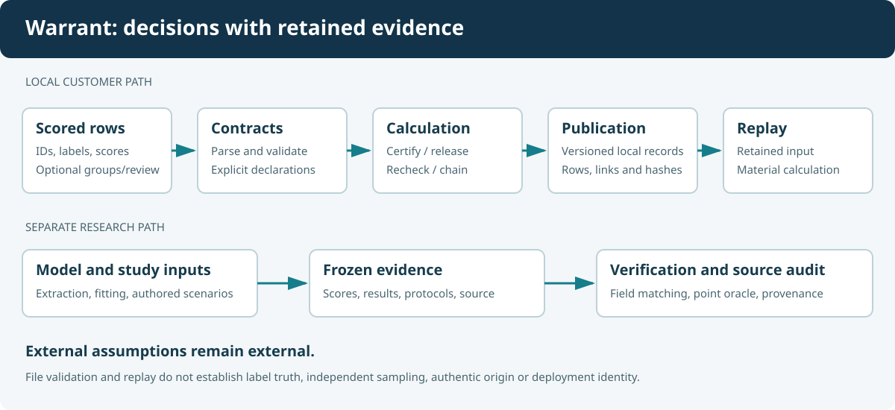

# Architecture and design

## Design objective

The central boundary is between a supplied detector score and a supported
statement about a decision. The implementation keeps input validation,
statistical calculation, record publication and replay separate so that a
failure in one does not silently masquerade as success in another.

This chapter describes the current local toolkit and the research modules.
Historical specifications sometimes describe an intended service or predicted
experimental outcome. The [product-state map](../../docs/PRODUCT-STATE.md)
identifies those distinctions.

## Component map

| Layer | Responsibilities | Main source |
|---|---|---|
| Command interface | Parse arguments, select a workflow, report exit status | [CLI](../../controlplane/cli.py), [release CLI](../../controlplane/release/cli.py) |
| Scored-file contract | Validate fields, identity, numeric values, grouping and labels | [Intake contract](../../controlplane/intake/contract.py) |
| Preparation | Apply explicit source mappings and retain replayable transformation evidence | [Prepare](../../controlplane/intake/prepare.py) |
| Evaluation | Select/evaluate an operating point and describe its metrics | [Certify](../../controlplane/intake/certify.py), [metric builder](../../controlplane/validation/metrics_builder.py) |
| Statistical primitives | Binomial calculations, resampling and sequential statistics | [Warrant statistics](../../controlplane/validation/warrant_stats.py), [statistics](../../controlplane/validation/stats.py) |
| Evidence integrity | Bind rows, version material fields, verify retained calculations | [Verify](../../controlplane/intake/verify.py), [selection](../../controlplane/intake/selection.py) |
| Local publication | Publish complete files, coordinate chain writers, detect interrupted state | [Atomic files](../../controlplane/intake/_atomic_files.py), [chain publication](../../controlplane/intake/chain_publication.py) |
| Registered studies | Freeze a release contract and evaluate its holdout | [Contract](../../controlplane/release/contract.py), [evaluate](../../controlplane/release/evaluate.py) |
| Research harness | Extract features, fit probes, run controls and study shifts | [Extraction](../../controlplane/extract/), [validation](../../controlplane/validation/) |
| Research evidence | Render results, verify claims and inspect provenance | [Reports](../../controlplane/report/), [audit implementation](../../controlplane/report/documentation_audit.py) |

## The customer execution path

A request enters through the CLI. Parsing should remain cheap and should not
load a model or import the heavy research runtime. Numerical and workflow
modules are loaded when needed.

The contract reader converts a supported file into structured scored items.
Downstream functions consume those items rather than independently parsing
CSV columns. This makes score direction, row identity and label meaning
explicit at one boundary.

Certification separates the threshold/FPR decision from the descriptive
metrics at that threshold. The record carries the effective-row identity so
verification can recompute material fields. Output is useful only when its
protocol, sampling unit and limitations remain attached.

The atomic writer's job is publication correctness. It does not decide
statistical validity. A complete but scientifically inappropriate record is
still possible if the input declarations or method assumptions are false.

## Records are different objects

A detector finding, an operating point, a warrant and a request certificate
serve different roles in the research model. In the installed workflows,
certificate JSON, frontier JSON, recheck records, chain records and release
contracts also have separate schemas.

Avoid treating a generic `status` string as the common API for everything.
The question, method, population and protocol determine what a status means.
Two records can use the same word while answering different questions.

The [record reference](records-and-protocols.md) covers version compatibility.
The [library reference](api-reference.md) identifies selected structured types.

## Persistence and publication

The research harness includes an append-only SQLite ledger and hash-linked
records. The installed scored-file workflows also publish local JSON and
directory artifacts. These are related evidence mechanisms, not one hosted
multi-tenant service.

The writer must distinguish a fully published artifact from an incomplete
directory or interrupted update. Chains add an authoritative local head and
writer coordination because two correct calculations published concurrently
can otherwise produce an ambiguous continuation.

A hash can reveal changes relative to retained bytes. It cannot establish
which copy is authoritative if every copy is replaceable. Local locks, hashes
and replay do not supply external signatures, trusted timestamps or a secure
deployment identity.

## Research execution path

Model loading and feature extraction are the GPU stage. The extraction code
retains generation outcomes, labels, feature variants and metadata in caches.
Most later experiments read those caches or frozen scored records.

The supervised linear probe fits its scaler and classifier on explicit training
indices. Validation chooses regularization and operating decisions. The
research harness runs positive and negative controls and records refusal
criteria along with ordinary metrics.

The long-context transfer path changes the input envelope used for feature
extraction while retaining the original questions, short-context answers and
labels. This is a representation-transfer experiment. It does not measure
freshly generated long-context answer accuracy.

Frozen per-item scores permit CPU replay of supported metric blocks. The
reproduction code explicitly distinguishes that replay from reconstructing
features and fitting the original probe.

## Policy, drift and action-gate demonstrations

The matrix keys evidence by detector, operating point and envelope. An
envelope change therefore cannot be repaired merely by selecting a different
detector name. Routing needs a qualifying warrant for the relevant context.

The drift path monitors declared distribution features and implements a
revocation ladder. The controlled replay demonstrates the ladder's operation;
it is not itself an estimate of production incident response.

The action gate adds a different control boundary: tool reversibility and
session state. Some of its decisions intentionally do not consult a detector.
The finite demonstration proves those decisions for its enumerated cases.
It does not establish adversarial robustness of an arbitrary application.

## Trust boundaries

| Supplied or assumed | What software can check | What remains external |
|---|---|---|
| Labels | Allowed values, retained rows and declared second-review information | Truth, rubric quality and reviewer independence |
| Groups | Syntax, membership and supported size restrictions | Whether groups reflect real dependence |
| System version | Equality with a registered value | Whether the deployed system actually matches it |
| Source history | Commit metadata, checksums and dirty flags | The full state of an unrecorded dirty run |
| Distribution | Observed features and declared sample design | Future transport and unobserved shifts |
| Retained evidence | Recalculation and local integrity | Authorship, trusted time and hidden alternate histories |

## Why the boundaries matter

Separating layers makes failures diagnosable. A malformed input should produce
an input error. A correct calculation with insufficient evidence should produce
a refusal. A modified retained record should fail replay. A missing optional
extraction cache should be reported as a skipped verification tier.

The [open FPR issue](limitations.md) illustrates another necessary boundary:
valid file structure and reproducible arithmetic cannot establish a stronger
statistical guarantee than the method supports.
